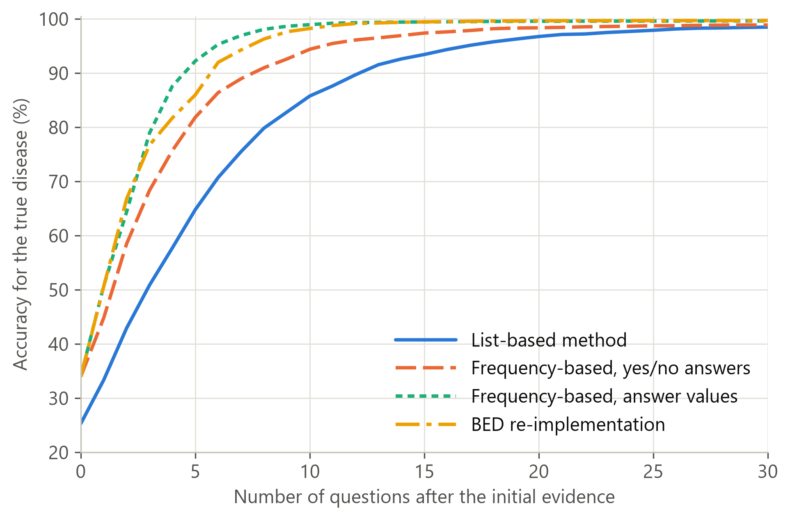

# DDXPlus의 공개 지식베이스는 대화형 과제에서 정답 질환을 얼마나 맞히는가

**How much of DDXPlus does its public knowledge base solve?**

## Abstract

DDXPlus는 대화형 감별진단 에이전트를 평가하는 합성 환자 벤치마크이고, 49개 질환마다 증상과 병력의 목록을 확률 없이 공개한다. 이 연구는 이 공개 목록만으로 정답 질환을 얼마나 맞히는지 쟀다. 공식 대화형 규칙에서 에이전트는 환자의 나이, 성별, 초기 evidence 1개를 받고 최대 30개까지 질문한다. 이 규칙에서 공개 목록만 쓰는 Bayes 방법과 목록 대신 train 환자의 빈도를 쓰는 변형을 평가했고, 문헌의 Bayes 실험설계 기준선인 BED를 다시 구현했다. 설정은 validation 세트에서 정하고 test 세트 134,529명에서 평가했다. train, validation, test 세트 어디에도 정답 질환의 목록 밖 양성 evidence를 가진 환자는 없었다. 목록만 쓰는 방법은 환자의 98.44%(95% 신뢰구간 98.38–98.51)에서 정답 질환을 맞혔고, 초기 evidence를 포함해 평균 10.35개의 evidence를 모았다. 목록 대신 빈도를 쓰면 정확도는 0.16%p 높아지고 수집 evidence는 3.08개 줄었다. 응답의 값까지 쓰면 정확도는 0.70%p 더 높아지고 수집 evidence는 2.17개 더 줄어, 99.30%와 5.10개가 되었다. BED 재구현은 보고값과 같은 99.47%와 5.48개를 냈다. 다만 BED의 시뮬레이터는 공식 규칙에서 "아니오"인 답을 양성으로 주며, test 환자의 39.0%가 이런 답을 한 번 이상 받았다. 공개 목록만으로 DDXPlus 환자의 98%에서 정답 질환이 식별된다. DDXPlus의 대화형 결과는 같은 규칙에서 돌린 공개 목록 기준선과 시뮬레이터의 응답 규칙을 함께 보고해야 한다.

**Keywords:** Diagnosis, Differential; Diagnosis, Computer-Assisted; Bayes Theorem; Knowledge Bases; Benchmarking

## 1. Introduction

문진으로 증상과 병력을 모아 진단 후보를 좁히는 과정을 자동화하려는 연구는 Bayes 정리를 쓴 초기 컴퓨터 진단 [1,2]에서 시작해, 환자에게 물을 질문을 스스로 고르는 대화형 진단 에이전트 [3,4]로 이어졌다. DDXPlus [5]는 이런 에이전트를 평가하는 벤치마크로, 49개 질환의 합성 환자 약 130만 명을 담고 있다. DDXPlus는 증상과 병력을 함께 evidence라 부른다. 대화형 과제에서 에이전트는 환자의 나이, 성별, 초기 evidence 1개를 받고, evidence를 하나씩 물은 뒤 감별진단을 낸다. 문헌의 에이전트는 train 환자로 학습한다 [5-9]. 최근에는 LLM 에이전트의 평가에도 DDXPlus나 그 파생 사례가 쓰인다 [10-12].

DDXPlus의 환자는 나이와 성별에 따라 달라지는 확률을 가진 비공개 의학 지식베이스, 인구조사 자료, Synthea로 합성되었다 [5,13]. 공개된 것은 그 가운데 질환별 evidence 목록뿐이고, 확률은 들어 있지 않다. 이 목록이 생성기가 각 질환에서 만들 수 있는 evidence의 범위를 담고 있다면, 환자 데이터로 학습하지 않고 목록만 써도 이 과제의 상당 부분이 풀릴 수 있다. 그러나 목록만으로 이 과제가 얼마나 풀리는지는 보고되지 않았다.

가장 가까운 선행연구는 BED [14]다. BED는 CASANDE [8]의 비교 기준선으로, 경사 기반 학습 없이 공개 목록과 train 빈도로 기대 정보이득이 큰 질문을 골라 묻는다. CASANDE 논문은 BED의 정답률을 99.47%, 평균 수집 evidence 수를 5.47개로 보고했다. BED는 진단 방법으로 제시되었고, 환자 데이터에서 센 빈도를 쓰며, 모든 정보를 넣은 결과 하나만 보고되었다. 그래서 공개 목록만으로 얻는 정확도와, 빈도와 그 밖의 정보가 더하는 몫은 이 결과에서 나눠 볼 수 없다.

이 연구는 새 진단 방법을 제안하지 않고 벤치마크를 잰다. 목적은 세 가지다. 첫째, 공식 프로토콜과 공식 test 세트 전체에서 공개 목록만 쓰는 Bayes 방법의 정확도와 질문 수를 잰다. 둘째, 목록 대신 train 빈도를 쓰고, 이어 나이·성별과 응답의 값을 더할 때 정확도와 질문 수가 얼마나 바뀌는지 잰다. 셋째, 이 측정을 해석하는 데 필요한 데이터셋 성질을 확인하고, 평가 시뮬레이터의 응답 규칙이 공식 프로토콜과 다를 때 결과가 받는 영향을 확인한다.

## 2. Materials and Methods

### 1) 자료

DDXPlus의 공개 자료 [15]를 썼다. 환자 기록은 나이, 성별, 정답 질환, 초기 evidence, 기록된 evidence, 정답 감별진단으로 이루어진다. evidence는 223개이고, 이진 208개, 범주형 10개, 다중선택 5개다. 범주형과 다중선택 evidence는 값을 가지며, 증상이 없음을 뜻하는 기본값이 정해져 있다. 범주형과 다중선택 가운데 14개는 통증, 피부 병변, 부종을 묻는 세 질문에 딸린 하위 질문이다. 이 연구는 기본값이 아닌 값이 기록된 evidence를 양성 evidence라 부른다.

공개 자료에는 질환마다 그 질환의 evidence 목록이 있다. 이 연구는 이 49개 목록을 공개 목록이라 부르고, 49개 질환 × 223개 evidence의 이진 행렬로 썼다. 어떤 질환의 목록은 다른 질환의 목록에 모두 포함된다. 예를 들어 안정형 협심증의 목록은 불안정형 협심증의 목록에, 만성 부비동염의 목록은 급성 부비동염의 목록에 포함된다.

분할은 공식 분할을 그대로 썼다. train 세트(1,025,602명)는 빈도 추정에만 썼다. validation 세트(132,448명)에서 설정을 고르고 요소 분석을 했다. test 세트(134,529명)에서 평가했다. test 세트의 결과는 두 부분집합으로도 나눠 보고한다. 하나는 나이, 성별, 초기 evidence, 기록된 evidence가 모두 같은 환자가 train 세트에 없는 132,540명이다. 다른 하나는 LLM 연구에서 쓰는 StreamBench [16]의 test 표본과 같은 1,764명이다.

이 연구는 공개된 합성 환자 자료만 썼고 사람을 대상으로 한 자료를 쓰지 않았다.

### 2) 대화형 평가 규칙

평가는 DDXPlus의 정의를 따랐다 [5,17]. 에이전트는 환자의 나이, 성별, 초기 evidence 1개를 받고 시작한다. 한 번에 evidence 하나를 묻고, 같은 질문은 다시 묻지 않는다. 초기 evidence 뒤에 최대 30개까지 물을 수 있다. 수집 evidence 수는 초기 evidence를 포함하므로 최대 31이다.

시뮬레이터는 환자 기록으로 답한다. 이진 evidence는 기록되어 있으면 "예"다. 범주형은 값 하나를, 다중선택은 값을 모두 알려 준다. 기록되지 않았거나 기록된 값이 기본값이면 "아니오"로 본다. 응답 방식은 두 가지를 평가했다. 이진 응답 방식에서 에이전트는 "예"와 "아니오"만 받는다. 값 단위 응답 방식에서는 범주형과 다중선택 evidence의 값도 받는다.

하위 질문은 상위 질문과 무관하게 물을 수 있고, 한 질문의 답으로 다른 질문의 답을 채우지 않는다. CASANDE의 시뮬레이터 [18]는 답을 채운다. 상위 질문이 "아니오"면 하위 질문을 "아니오"로, 하위 질문이 "예"면 상위 질문을 "예"로 채우고, 채운 답은 질문 수에 세지 않는다. 이 규칙의 영향은 민감도 분석으로 따로 평가했다.

에이전트는 마지막에 49개 질환의 확률분포를 낸다. 이 연구가 재는 것은 그 1위가 정답 질환인지다. 정답 감별진단은 환자를 만든 생성기가 아니라 별도의 상용 진단 시스템이 붙인 레이블이므로 [5] 목표로 삼지 않았다.

### 3) 진단 방법

두 방법 모두 49개 질환의 사후분포를 Bayes 정리로 갱신하며, evidence는 질환이 주어지면 서로 독립이라고 가정한다.

목록 기반 방법 P1은 공개 목록만 쓴다. 질환의 목록에 evidence가 있으면 "예"의 확률을 α로, 없으면 ε로 둔다. 사전확률은 균등하다. 응답은 이진 응답 방식으로 받고, 시작 입력 가운데 초기 evidence만 쓴다. P1은 환자 자료에서 아무 값도 추정하지 않는다.

빈도 기반 방법 P2는 질환의 사전확률과 질환별 evidence의 확률을 train 세트의 빈도로 추정한다. 빈도에는 가산 1의 Laplace 평활을 했다. P2에는 네 변형이 있다. 응답 방식이 이진인지 값 단위인지, 그리고 나이와 성별을 쓰는지로 나뉜다. 나이와 성별은 사전확률에만 넣었고, 나이는 DDXPlus의 8개 구간으로 나눴다. 값 단위 응답에서 다중선택 evidence는 CASANDE 논문의 처리 [8]를 따라 선택지마다 따로 다뤘다.

두 방법은 기대 정보이득 [19]이 가장 큰 evidence를 묻는다. 기대 정보이득은 답을 들은 뒤 사후분포의 엔트로피가 평균적으로 줄어드는 양이다. 질문은 세 조건 가운데 하나가 먼저 충족되면 멈춘다. 첫째는 사후확률의 최댓값이 0.99 이상인 경우다. 둘째는 남은 evidence의 기대 정보이득이 모두 10⁻⁶ nats 미만인 경우다. 셋째는 질문이 30개에 이른 경우다. 종료 임계 0.99는 모든 방법에 똑같이 두었다.

### 4) 비교 방법

BED는 공개 코드 [18]의 규칙대로 다시 구현했다. 지식으로는 그 코드에 든 train 통계 파일을 읽는다. BED는 나이와 성별을 쓰지 않고, 값 단위로 답을 받으며, 질문의 효용이 모두 0.01 미만이면 멈춘다. 응답에는 BED 코드의 자체 시뮬레이터를 썼다. 이 시뮬레이터는 기록된 evidence를 값과 무관하게 양성으로 답한다. 공식 규칙에서 "아니오"인 기록된 기본값도 양성으로 답한다는 점이 2)의 규칙과 다르다. 재구현이 원 코드와 같은지는 원 코드를 validation 세트 전체에 돌려 확인했다.

질문을 하지 않는 기준 두 가지를 두었다. 하나는 train 세트에서 가장 흔한 질환을 답하는 것이고, 다른 하나는 초기 evidence만 반영한 P1의 사후분포로 답하는 것이다. 환자의 기록 전체를 질문 없이 주는 참조값도 구했다. 양성 evidence를 모두 담는 목록을 가진 질환을 고르는 목록 대조, P1의 확률을 기록 전체에 적용한 값, P2의 확률을 기록 전체에 적용한 naive Bayes가 여기에 든다.

질문 순서의 영향을 보려고 P1의 질문 선택만 바꾼 두 방법을 평가했다. 하나는 목록 밖 양성 응답이 가장 적은 질환들의 목록 안에서 무작위로 묻는다. 무작위 순서는 다섯 번 바꿔 평균을 냈다. 다른 하나는 공개 목록 없이 train 세트에서 흔한 evidence부터 묻는다.

### 5) 요소 분석

요소 분석은 validation 세트에서만 했다. P1의 한 요소를 바꾸고 나머지는 그대로 두었다. 바꾼 요소는 다섯 가지다. 첫째, 질문에 대한 "예"만 또는 "아니오"만 사후분포에 반영했다. 둘째, ε를 0.1에서 10⁻⁹까지 바꿨다. 셋째, 질문 선택을 바꿨다. 후보 질환들의 목록에 가장 많이 든 evidence를 묻는 방법과 4)의 두 방법이다. 넷째, 하위 질문의 처리를 바꿨다. 답을 채우는 규칙, 상위 질문이 "예"일 때만 하위 질문을 묻는 규칙, 하위 질문을 묻지 않는 규칙이다. 다섯째, 균등 사전확률을 train 세트의 질환 빈도로 바꿨다.

### 6) 설정 선택

validation 세트에서 고른 값은 P1의 α와 ε뿐이다. 후보는 α 0.3, 0.5, 0.7과 ε 10⁻², 10⁻³, 10⁻⁴의 아홉 조합이고, 정확도가 가장 높은 조합을 골랐다. 종료 임계와 평활 값은 고르지 않고 고정했다. 종료 임계는 정확도와 질문 수를 맞바꾸는 값이므로, 임계를 0.9, 0.95, 0.99, 0.999로 바꾼 결과를 함께 보고한다.

### 7) 평가 지표와 통계 분석

일차 지표는 정답 질환 정확도다. 문헌의 GTPA@1 [5]에 해당하며, 마지막 확률분포의 1위가 정답 질환인 환자의 비율이다. 1위가 여러 질환의 동점이고 정답이 그 안에 있으면 동점인 질환 수로 나눈 점수를 주었다. 또 하나의 지표는 평균 수집 evidence 수로, 문헌의 IL [5]에 해당한다. 공식 코드의 식으로 계산한 정확도와 감별진단 지표는 Supplementary에 실었다.

종료 임계와 무관한 비교를 위해 질문 수에 따른 정확도도 구했다. 종료 조건 없이 정해진 수만큼 물은 뒤의 정확도다.

데이터셋 성질로는 네 가지를 쟀다. 정답 질환의 목록 밖에 양성 evidence를 가진 환자 수, 양성 evidence를 모두 담는 목록이 정답 질환 하나뿐인 환자의 비율, 정답 감별진단의 1위가 정답 질환인 환자의 비율, 그리고 정답 감별진단의 확률 가운데 환자의 양성 evidence를 모두 담지 못하는 목록의 질환에 놓인 몫이다. BED 재구현에서는 물은 범주형과 다중선택 질문 가운데, 공식 규칙으로는 "아니오"인데 BED 시뮬레이터가 양성으로 답한 수를 셌다.

비율에는 Wilson 95% 신뢰구간 [20]을, 평균과 짝 차이에는 환자 단위 bootstrap 2,000회의 95% 신뢰구간 [21]을 달았다. 두 방법의 정확도는 같은 환자에서 짝지어 비교했고, 정확 McNemar 검정 [22]의 p값은 다중비교 보정 없이 기술 목적으로만 적었다. 신뢰구간은 환자 표집의 변동만 반영한다.

## 3. Results

### 1) 자료의 성질

정답 질환의 목록 밖에 양성 evidence를 가진 환자는 train, validation, test 세트 어디에도 없었다. 양성 evidence를 모두 담는 목록이 정답 질환 하나뿐인 환자는 validation 세트에서 92.35%, test 세트에서 92.40%였다.

반대로 목록에 있는 evidence가 그 질환의 환자에게 늘 나타나지는 않았다. 질환과 evidence의 쌍으로 센 목록 항목은 888개다. 이 가운데 46개는 train 세트에서 한 번도 양성이 아니었다. 그 질환의 환자 가운데 evidence가 양성인 비율이 5% 미만인 항목은 10.4%였고, 99% 이상인 항목은 22.6%였다.

validation 세트에서 정답 감별진단의 1위가 정답 질환인 환자는 73.4%였다. 정답 감별진단의 확률 가운데 평균 70.1%는 환자의 양성 evidence를 모두 담지 못하는 목록의 질환에 놓여 있었다.

### 2) test 세트의 정확도와 수집 evidence 수

P1의 아홉 후보는 validation 세트에서 97.72–98.42%의 정확도를 보였고, α 0.5와 ε 10⁻⁴가 선택되었다(Supplementary Table S6). Table 1은 이 설정으로 test 세트 134,529명을 평가한 결과다. 실행 중 오류가 난 환자는 없었다.

P1은 환자의 98.44%(95% 신뢰구간 98.38–98.51)에서 정답 질환을 맞혔고, 초기 evidence를 포함해 평균 10.35개(10.31–10.39)의 evidence를 모았다. 질문이 30개에 이르러 멈춘 환자는 3.27%였다. train 세트에 같은 입력의 환자가 없는 132,540명에서 P1의 정확도는 98.42%(98.36–98.49)였고, StreamBench와 같은 1,764명에서는 98.11%(97.36–98.65)였다(Supplementary Table S5).

요인을 하나씩 바꾼 짝 비교는 다음과 같았다(Supplementary Table S4). 목록 대신 train 빈도를 쓴 P2는 이진 응답에서 P1보다 정확도가 0.16%p(0.09–0.22) 높았고, 수집 evidence가 3.08개(3.05–3.11) 적었다. 여기에 나이와 성별을 더하면 정확도가 0.06%p(0.03–0.08) 높아지고 수집 evidence가 0.15개(0.14–0.16) 줄었다. 응답의 값을 쓰면 이진 응답보다 정확도가 0.70%p(0.65–0.76) 높았고 수집 evidence가 2.17개(2.15–2.20) 적었다. 값 단위 응답에서 나이와 성별을 더하면 정확도는 0.02%p(0.00–0.03) 낮아지고 수집 evidence는 0.13개(0.12–0.13) 줄었다.

종료 임계를 0.9에서 0.999까지 바꾸면 P1의 정확도는 98.11%에서 98.49%로, 수집 evidence는 9.02개에서 13.25개로 달라졌다(Supplementary Table S2). P2 이진 응답과 P1의 정확도 차이는 임계 0.9에서 −1.31%p, 임계 0.999에서 +0.37%p였다. 수집 evidence는 네 임계 모두에서 P2가 3.08–4.34개 적었다.

하위 질문의 답을 채우는 규칙으로 바꾸면 정확도가 P1에서 0.11%p(0.08–0.15), P2의 네 변형에서 0.10–0.14%p 낮아졌고, 수집 evidence는 0.06–0.43개 줄었다.

질환별로 보면 P1의 정확도가 가장 낮은 질환은 급성 부비동염으로 67.2%였다. 이 질환의 정확도는 P2 이진 응답에서 67.1%, 값 단위 응답에서 84.4%였다.

질문을 하지 않는 기준의 정확도는 가장 흔한 질환을 답할 때 6.50%, 초기 evidence만 쓸 때 25.29%였다. 환자의 기록 전체를 질문 없이 주면 목록 대조는 95.93%, P1의 확률은 99.19%, naive Bayes는 이진 응답에서 99.28%, 값 단위 응답에서 99.70%였다(Supplementary Table S7).

**Table 1. Accuracy for the true disease and number of evidences collected on the test set (134,529 patients)**

| Method | Knowledge | Input at start | Answers | Accuracy, % (95% CI) | Evidence collected, mean (95% CI) | Median | Stopped at the question limit, % |
|---|---|---|---|---|---|---|---|
| List-based method (P1) | Public lists | Initial evidence | Yes or no | 98.44 (98.38–98.51) | 10.35 (10.31–10.39) | 9 | 3.27 |
| Frequency-based method (P2) | Training frequencies | Initial evidence | Yes or no | 98.60 (98.54–98.66) | 7.27 (7.24–7.31) | 6 | 1.75 |
| P2 with age and sex | Training frequencies | Age, sex, initial evidence | Yes or no | 98.66 (98.60–98.72) | 7.12 (7.09–7.16) | 6 | 1.69 |
| P2 with answer values | Training frequencies | Initial evidence | Values | 99.30 (99.26–99.35) | 5.10 (5.07–5.12) | 4 | 0.41 |
| P2 with answer values, age and sex | Training frequencies | Age, sex, initial evidence | Values | 99.29 (99.24–99.33) | 4.97 (4.95–4.99) | 4 | 0.40 |
| BED re-implementation | Public lists and training frequencies^a)^ | Initial evidence | Values, BED simulator | 99.47 (99.43–99.51) | 5.48 (5.45–5.50) | 5 | 0.01 |

CI, confidence interval; BED, Bayesian experimental design baseline.
Evidence collected includes the initial evidence. P1 and P2 stop when the largest posterior probability reaches 0.99; BED stops by its own rule.
^a)^The statistics file of the training patients distributed with the BED code.

### 3) 질문 수에 따른 정확도

Figure 1은 종료 조건 없이 정해진 수만큼 물었을 때의 정확도다. 질문 30개 뒤의 정확도는 P1 98.49%, P2 이진 응답 98.88%, P2 값 단위 응답 99.63%, BED 재구현 99.71%였다. 정확도가 95%에 처음 닿는 질문 수는 P1 17개, P2 이진 응답 11개, P2 값 단위 응답 6개, BED 재구현 8개였다. P2 이진 응답과 P1의 정확도 차이는 질문 5개에서 17.05%p(16.79–17.30)였고 질문 30개에서 0.39%p(0.33–0.44)였다. P1의 질문 선택만 바꾸면 질문 30개 뒤의 정확도가 무작위 질문에서 88.45%, 빈도순 질문에서 83.57%였다(Supplementary Table S3).

**Figure 1.** Accuracy for the true disease on the test set by number of questions asked after the initial evidence. Each method asks exactly the given number of questions without a stop rule. The frequency-based methods shown do not use age and sex. BED, Bayesian experimental design baseline.

### 4) BED 재구현과 응답 규칙

validation 세트에서 BED의 원 코드는 정확도 99.442%와 수집 evidence 5.472개를, 재구현은 99.442%와 5.476개를 냈다. test 세트에서 재구현의 정확도는 99.47%(99.43–99.51), 수집 evidence는 5.48개(5.45–5.50)였다. CASANDE 논문이 보고한 BED의 값은 99.47%와 5.47개다 [8]. 감별진단 지표도 보고값과 같았다(Supplementary Table S1).

BED 재구현이 test 세트에서 물은 범주형과 다중선택 질문은 315,692개였다. 이 가운데 193,028개는 공식 규칙으로 "아니오"였고, 그 가운데 60,261개에 BED의 시뮬레이터는 양성으로 답했다. 이런 답을 한 번 이상 받은 환자는 52,404명으로 test 세트의 38.95%였다. validation 세트의 기록에서 범주형과 다중선택 evidence는 정답 질환의 목록에 있으면 값이 기본값이어도 모두 기록되어 있었고, 목록에 없으면 기록되어 있지 않았다.

공식 규칙으로 답을 받고 나이와 성별을 쓰지 않는 P2 값 단위 응답과 같은 환자에서 비교하면, BED 재구현은 정확도가 0.16%p(0.12–0.21) 높았고 수집 evidence가 0.38개(0.36–0.40) 많았다. P2 값 단위 응답의 종료 임계를 0.999로 두면 정확도는 99.53%, 수집 evidence는 6.01개였다. 질문 수를 맞춰 비교하면 질문 5개에서는 P2가 6.25%p, 10개에서는 0.71%p 높았고, 20개에서는 BED 재구현이 0.09%p, 30개에서는 0.08%p 높았다.

### 5) 요소 분석

Table 2는 validation 세트에서 P1의 요소를 하나씩 바꾼 결과다. 질문에 대한 "예"만 반영하면 정확도가 86.64%였고, "아니오"만 반영하면 57.94%였다. 초기 evidence만 쓴 정확도는 25.22%였다. ε를 10⁻²에서 10⁻⁹까지 바꿔도 정확도는 98.17–98.42%였고, ε가 0.1이면 94.95%였다. 질문 선택을 바꾸면 정확도가 83.30–91.11%였다. 하위 질문을 상위 질문이 "예"일 때만 물으면 정확도가 0.24%p 높았고, 하위 질문을 묻지 않으면 0.20%p 높았다. 사전확률을 train 세트의 질환 빈도로 바꾸면 정확도가 0.25%p 낮았다.

**Table 2. Component analysis of the list-based method on the validation set (132,448 patients)**

| Changed component | Accuracy, % (95% CI) | Difference from P1, percentage points (95% CI) | Evidence collected, mean |
|---|---|---|---|
| List-based method (P1) | 98.42 (98.35–98.49) | – | 10.39 |
| *Answers used* |  |  |  |
| Only “yes” answers to questions | 86.64 (86.45–86.82) | −11.78 (−11.93 to −11.63) | 14.23 |
| Only “no” answers to questions | 57.94 (57.68–58.21) | −40.48 (−40.73 to −40.23) | 26.36 |
| *Probability of “yes” for an evidence outside the list (ε)* |  |  |  |
| ε = 0.1 | 94.95 (94.83–95.07) | −3.47 (−3.56 to −3.37) | 23.24 |
| ε = 10^−2^ | 98.17 (98.09–98.24) | −0.25 (−0.29 to −0.22) | 13.49 |
| ε = 10^−9^ | 98.37 (98.30–98.43) | −0.06 (−0.08 to −0.04) | 9.90 |
| *Question selection* |  |  |  |
| Evidence on the most candidate lists | 91.11 (90.95–91.26) | −7.31 (−7.45 to −7.18) | 20.26 |
| Random evidence from the candidate lists^a)^ | 88.46 (88.37–88.52) | −9.96 (−10.05 to −9.90) | 14.83 |
| Most frequent evidence in the training set first | 83.30 (83.10–83.50) | −15.12 (−15.29 to −14.93) | 22.31 |
| *Sub-questions* |  |  |  |
| Answers filled in | 98.32 (98.25–98.39) | −0.10 (−0.13 to −0.06) | 9.96 |
| Asked only after “yes” to the main question | 98.67 (98.60–98.73) | +0.24 (+0.21 to +0.28) | 10.30 |
| Never asked | 98.62 (98.56–98.68) | +0.20 (+0.17 to +0.24) | 10.36 |
| *Prior probability* |  |  |  |
| Disease frequencies of the training set | 98.17 (98.10–98.24) | −0.25 (−0.30 to −0.21) | 10.18 |

CI, confidence interval.
Each row changes one component of P1 and keeps the others.
^a)^Mean of five random orders; the range over the five orders is shown in place of the CI.

### 6) 문헌 보고값과의 비교

Table 3은 DDXPlus에서 보고된 값과 평가 조건이다. 공식 대화형 규칙으로 test 세트 전체를 평가한 연구에서, 정답 질환으로 학습한 모형의 정확도는 91.81–99.21%, 평균 수집 evidence 수는 6.73–19.53개로 보고되었다. 이 모형들은 train 환자로 학습하고 나이와 성별을 입력으로 받는다. 보고된 95% 신뢰구간의 반폭은 정확도에서 0.54–1.95%p다 [8]. LLM을 쓴 연구는 평가한 환자 수, 시작 입력, 응답 방식이 공식 규칙과 달랐다.

**Table 3. Results reported on DDXPlus and their evaluation conditions**

| Study | Knowledge used | Patients evaluated | Input at start | Answers | Question limit | Accuracy, % | Evidence collected, mean^a)^ |
|---|---|---|---|---|---|---|---|
| *Official interactive rules, whole test set* |  |  |  |  |  |  |  |
| AARLC [6]^b)^ | Training patients | 134,529 | Age, sex, initial evidence | Patient record | 30 | 99.21 | 6.73 |
| BASD [7]^b)^ | Training patients | 134,529 | Age, sex, initial evidence | Patient record | 30 | 97.15 | 17.99 |
| Diaformer [9]^c)^ | Training patients | 134,529 | Age, sex, initial evidence | Patient record | 30 | 91.81 | 18.45 |
| CASANDE [8]^c)^ | Training patients | 134,529 | Age, sex, initial evidence | Patient record, sub-question answers filled in | 30 | 98.8 | 19.53 |
| BED [14]^c)^ | Public lists and training frequencies | 134,529 | Initial evidence | BED simulator | 30 | 99.47 | 5.47 |
| This study, list-based method (P1) | Public lists | 134,529 | Initial evidence | Patient record, yes or no | 30 | 98.44 | 10.35 |
| This study, frequency-based method (P2) with answer values, age and sex | Training frequencies | 134,529 | Age, sex, initial evidence | Patient record with values | 30 | 99.29 | 4.97 |
| This study, BED re-implementation | Public lists and training frequencies | 134,529 | Initial evidence | BED simulator | 30 | 99.47 | 5.48 |
| *Other conditions* |  |  |  |  |  |  |  |
| CaRDI [23]^d)^ | Training frequencies and an LLM prior | 490 from the test set | Age, sex, initial evidence | Patient record with values | 10 | 96.12–96.69 | 4.54–4.64 |
| MEDDxAgent [10]^e)^ | LLM | 100 from the StreamBench patients | Age, sex, chief complaint | LLM patient simulator | 15 | 86 | NR |
| StreamBench [16]^f)^ | LLM | 1,764 from the test set | Full patient record | None | 0 | 70.64–92.01 | NA |

LLM, large language model; NR, not reported; NA, not applicable.
^a)^Including the initial evidence.
^b)^Model trained to predict the true disease; values from Table 3 of the DDXPlus paper [5].
^c)^Model trained to predict the true disease, and BED; values from Table 1 of the CASANDE paper [8].
^d)^Range over three LLMs; the reported 3.54–3.64 questions after the initial evidence are shown with the initial evidence added.
^e)^GPT-4o on the interactive task after 15 questions.
^f)^GPT-4o, from zero-shot prompting to the best reported method.

## 4. Discussion

공개 목록만 쓰는 Bayes 방법은 공식 규칙의 test 세트 전체에서 환자의 98.44%에서 정답 질환을 맞혔다. 이 방법은 환자 자료에서 확률을 추정하지 않았고, validation 세트에서 고른 값은 둘뿐이다. DDXPlus의 높은 대화형 정확도는 학습이나 언어 모형 없이 공개 목록만으로도 얻어진다.

이 결과는 DDXPlus 환자의 양성 evidence가 정답 질환의 목록을 한 번도 벗어나지 않는다는 성질과 이어져 있다. P1은 목록 밖 evidence에 "예"가 나오면 그 질환의 확률을 크게 낮춘다. 목록 밖 양성 evidence를 가진 환자가 없으므로 이 규칙은 정답 질환을 지우지 않는다. 요소 분석에서 "예"만 반영한 정확도는 86.64%, "아니오"만 반영한 정확도는 57.94%였고, ε가 10⁻² 이하이면 정확도는 그 크기에 거의 달라지지 않았다. 질문 선택의 몫도 컸다. 같은 확률을 쓰고 질문 순서만 바꾸면 정확도가 83.30–91.11%로 낮아졌다. 실제 환자 기록에서도 이 성질이 성립하는지는 이 연구가 재지 않았다. 그러므로 DDXPlus의 높은 대화형 정확도만으로는 실제 환자에서의 진단 능력을 판단할 수 없다.

목록을 train 빈도로 바꾸면 정확도보다 질문 수가 달라졌다. 종료 임계 0.99에서 정확도는 0.16%p 높아졌고 수집 evidence는 3.08개 줄었다. 정확도 차이는 종료 임계에 따라 부호가 바뀌었지만, 수집 evidence는 모든 임계에서 3개 이상 줄었다. 질문 수를 맞추면 차이는 처음 몇 질문에서 컸고 질문 30개에서는 0.39%p였다. 응답의 값은 정확도를 0.70%p 높이고 수집 evidence를 2.17개 줄여, 빈도보다 정확도에 주는 몫이 컸다. 나이와 성별을 사전확률에 더한 효과는 정확도에서 0.06%p 이하, 수집 evidence에서 0.15개 이하였다. 다만 생성기는 나이와 성별을 evidence의 확률에도 쓰는데, 이 연구는 사전확률에만 넣었다.

BED 재구현은 보고값을 재현했다. 그러나 BED의 시뮬레이터는 공식 규칙에서 "아니오"인 기록된 기본값을 양성으로 답한다. 기록에서 범주형과 다중선택 evidence는 정답 질환의 목록에 있을 때만, 값이 기본값이어도 기록되어 있었다. 그래서 이 답은 그 evidence가 정답 질환의 목록에 있는지를 알려 준다. 공식 규칙의 에이전트는 받을 수 없는 정보다. test 환자의 39.0%가 이런 답을 한 번 이상 받았다. 이 차이가 BED의 수치에 주는 몫은 이 연구에서 분리하지 못했다. BED의 추론식에는 공식 규칙의 "아니오"에 해당하는 정의가 없어, 시뮬레이터만 바꾼 BED가 하나로 정해지지 않기 때문이다. 대신 같은 종류의 지식을 공식 규칙으로 쓰는 P2 값 단위 응답과 비교했다. P2는 종료 임계 0.99에서 정확도가 0.16%p 낮고 수집 evidence가 0.38개 적었으며, 임계 0.999에서는 99.53%와 6.01개였다. 두 방법은 효용, 종료 규칙, 평활도 다르므로 이 차이를 시뮬레이터의 효과로 읽을 수는 없다. 확인된 것은 공식 규칙에서도 evidence를 0.53개 더 모으면 BED가 보고한 수준의 정확도에 이른다는 점이다. BED의 수치를 인용할 때는 시뮬레이터의 응답 규칙을 함께 적어야 한다.

문헌에서 정답 질환으로 학습한 모형의 정확도는 91.81–99.21%로 보고되었고, P1의 98.44%는 이 범위 안에 있다. 이 모형들은 나이와 성별을 입력으로 받고 보고된 신뢰구간도 넓으므로, 우열은 말할 수 없다. P1은 생성기가 각 질환에서 만들 수 있는 evidence의 범위를 담은 목록을 미리 알고 시작한다는 점에서도 다르다. 학습한 모형은 이 범위를 환자 자료에서 배워야 한다. 이 연구가 보인 것은 학습한 모형이 무엇을 배웠는지가 아니라, 공개 목록만으로 이르는 수준이다. LLM을 쓴 연구는 환자 수와 응답 방식이 달라 같은 선에서 비교할 수 없다. DDXPlus 논문이 밝혔듯이 정답 질환 정확도는 정답 질환으로 학습한 모형에서만 의미가 있다 [5]. 감별진단 분포로 학습한 모형의 값과 섞어 비교해서는 안 된다.

이 결과에서 보고에 관한 권고가 나온다. DDXPlus의 대화형 결과에는 같은 규칙에서 돌린 공개 목록 기준선을 함께 보고할 것을 권한다. 시뮬레이터가 기본값을 어떻게 답하는지와 하위 질문의 답을 채우는지도 적어야 한다. 하위 질문의 답을 채우는 규칙만으로 정확도가 0.10–0.14%p 달라졌기 때문이다. 종료 규칙과 수집 evidence 수의 정의도 함께 적어야 한다. 종료 임계에 따라 P1의 수집 evidence는 9.02개에서 13.25개까지 달라졌다.

이 연구에는 한계가 있다. 첫째, 합성 자료에서 얻은 결과이며, 임상 적용 가능성이나 다른 에이전트에 대한 우위를 뜻하지 않는다. 둘째, 두 방법은 evidence가 서로 독립이라고 가정한다. 하위 질문에서는 이 가정이 맞지 않으며, 요소 분석에서 하위 질문을 제한하면 정확도가 0.20–0.24%p 높았다. 셋째, 종료 임계는 고르지 않고 0.99로 두었다. 신뢰구간은 환자 표집의 변동만 담으므로, 임계와 같은 설계 선택에 따른 차이는 신뢰구간보다 클 수 있다. 넷째, BED 재구현이 원 코드와 같은지는 validation 세트에서 확인했고, test 세트에서는 원 코드를 돌리지 않았다. 다섯째, 정답 감별진단은 평가하지 않았다. 정답 감별진단은 공개 목록과 다른 시스템이 만든 레이블이고, 그 확률의 70.1%가 공개 목록으로는 해당하지 않는 질환에 놓여 있었다.

결론적으로, DDXPlus의 공개 목록만 쓰는 Bayes 방법은 공식 규칙에서 환자의 98.44%에서 정답 질환을 맞혔다. 환자 빈도는 주로 질문 수를 줄였고, 응답의 값은 정확도와 질문 수를 함께 개선했다. DDXPlus로 대화형 진단 에이전트를 평가할 때는 같은 규칙의 공개 목록 기준선과 시뮬레이터의 응답 규칙을 함께 보고할 것을 권한다.

## Data Availability

DDXPlus는 공개 자료다 [15]. 이 연구의 코드, 설정, 환자별 출력은 [공개 주소 작성 필요]에 있다.

## Acknowledgments

[저자 작성]

## Conflict of Interest Disclosure Statement

[투고 직전 작성]

## References

1. Warner HR, Toronto AF, Veasey LG, Stephenson R. A mathematical approach to medical diagnosis: application to congenital heart disease. JAMA. 1961;177(3):177-83. doi:10.1001/jama.1961.03040290005002
2. de Dombal FT, Leaper DJ, Staniland JR, McCann AP, Horrocks JC. Computer-aided diagnosis of acute abdominal pain. Br Med J. 1972;2(5804):9-13. doi:10.1136/bmj.2.5804.9
3. Wei Z, Liu Q, Peng B, Tou H, Chen T, Huang X, et al. Task-oriented dialogue system for automatic diagnosis. In: Proceedings of the 56th Annual Meeting of the Association for Computational Linguistics (Volume 2: Short Papers); 2018 Jul 15-20; Melbourne, Australia. Association for Computational Linguistics; 2018. p. 201-7. doi:10.18653/v1/P18-2033
4. Kao HC, Tang KF, Chang EY. Context-aware symptom checking for disease diagnosis using hierarchical reinforcement learning. Proc AAAI Conf Artif Intell. 2018;32(1):2305-13. doi:10.1609/aaai.v32i1.11902
5. Fansi Tchango A, Goel R, Wen Z, Martel J, Ghosn J. DDXPlus: a new dataset for automatic medical diagnosis. Adv Neural Inf Process Syst. 2022;35:31306-18. doi:10.52202/068431-2270
6. Yuan H, Yu S. Efficient symptom inquiring and diagnosis via adaptive alignment of reinforcement learning and classification. Artif Intell Med. 2024;148:102748. doi:10.1016/j.artmed.2023.102748
7. Luo H, Li SW, Glass J. Knowledge grounded conversational symptom detection with graph memory networks. In: Proceedings of the 3rd Clinical Natural Language Processing Workshop; 2020 Nov; Online. Association for Computational Linguistics; 2020. p. 136-45. doi:10.18653/v1/2020.clinicalnlp-1.16
8. Fansi Tchango A, Goel R, Martel J, Wen Z, Marceau Caron G, Ghosn J. Towards trustworthy automatic diagnosis systems by emulating doctors' reasoning with deep reinforcement learning. Adv Neural Inf Process Syst. 2022;35:24502-15. doi:10.52202/068431-1779
9. Chen J, Li D, Chen Q, Zhou W, Liu X. Diaformer: automatic diagnosis via symptoms sequence generation. Proc AAAI Conf Artif Intell. 2022;36(4):4432-40. doi:10.1609/aaai.v36i4.20365
10. Rose DP, Hung CC, Lepri M, Alqassem I, Gashteovski K, Lawrence C. MEDDxAgent: a unified modular agent framework for explainable automatic differential diagnosis. In: Proceedings of the 63rd Annual Meeting of the Association for Computational Linguistics (Volume 1: Long Papers); 2025 Jul; Vienna, Austria. Association for Computational Linguistics; 2025. p. 13803-26. doi:10.18653/v1/2025.acl-long.677
11. Gao Y, Zhou X, Li Y, Zhao Y, Liu R. MedExAgent: training LLM agents to ask, examine, and diagnose in noisy clinical environments [Preprint]. arXiv:2605.07058v1. 2026 [cited 2026 Nov 15]. Available from: https://arxiv.org/abs/2605.07058
12. Qiu P, Wu C, Liu J, Zheng Q, Liao Y, Wang H, et al. Evolving interactive diagnostic agents in a virtual clinical environment [Preprint]. arXiv:2510.24654v2. 2026 [cited 2026 Nov 15]. Available from: https://arxiv.org/abs/2510.24654
13. Walonoski J, Kramer M, Nichols J, Quina A, Moesel C, Hall D, et al. Synthea: an approach, method, and software mechanism for generating synthetic patients and the synthetic electronic health care record. J Am Med Inform Assoc. 2018;25(3):230-8. doi:10.1093/jamia/ocx079
14. Guan H, Baral C. A Bayesian approach for medical inquiry and disease inference in automated differential diagnosis [Preprint]. arXiv:2110.08393. 2021 [cited 2026 Nov 15]. Available from: https://arxiv.org/abs/2110.08393
15. Fansi Tchango A, Goel R, Wen Z, Martel J, Ghosn J. DDXPlus Dataset [dataset]. Version 15. figshare; 2022. doi:10.6084/m9.figshare.20043374.v15
16. Wu CK, Tam ZR, Lin CY, Chen YN, Lee HY. StreamBench: towards benchmarking continuous improvement of language agents. Adv Neural Inf Process Syst. 2024;37:107039-63. doi:10.52202/079017-3398
17. Mila - Quebec AI Institute. ddxplus [software]. GitHub; commit 69e8cf5 [cited 2026 Nov 15]. Available from: https://github.com/mila-iqia/ddxplus
18. Mila - Quebec AI Institute. Casande-RL [software]. GitHub; commit 5279013 [cited 2026 Nov 15]. Available from: https://github.com/mila-iqia/Casande-RL
19. Lindley DV. On a measure of the information provided by an experiment. Ann Math Stat. 1956;27(4):986-1005. doi:10.1214/aoms/1177728069
20. Wilson EB. Probable inference, the law of succession, and statistical inference. J Am Stat Assoc. 1927;22(158):209-12. doi:10.1080/01621459.1927.10502953
21. Efron B. Bootstrap methods: another look at the jackknife. Ann Stat. 1979;7(1):1-26. doi:10.1214/aos/1176344552
22. McNemar Q. Note on the sampling error of the difference between correlated proportions or percentages. Psychometrika. 1947;12(2):153-7. doi:10.1007/BF02295996
23. Zhou Y, Zhou H, Zhang J, Wang K, Rao Z, Wang M, et al. Beyond uncertainty reduction: calibrated planning for interactive diagnosis [Preprint]. arXiv:2608.27847v2. 2026 [cited 2026 Nov 15]. Available from: https://arxiv.org/abs/2608.27847

## Supplementary Material

### Supplementary Methods

**1. 확률의 정의.** P1에서 질환 d의 목록에 evidence e가 있으면 P(예 ∣ d) = α, 없으면 ε다. P2에서 n(d)는 train 세트의 질환 d 환자 수, n(d, e)는 그 가운데 e가 양성인 환자 수다. 이진 응답 방식의 확률은 P(예 ∣ d) = (n(d, e) + 1) / (n(d) + 2)다. 값 단위 응답 방식에서 범주형 evidence는 기본값을 포함한 값 K개에 대해 P(값 v ∣ d) = (n(d, e, v) + 1) / (n(d) + K)로 두고, 다중선택 evidence는 기본값이 아닌 선택지마다 P(선택 ∣ d) = (n(d, e, v) + 1) / (n(d) + 2)로 둔다. 사전확률은 P(d) = (n(d) + 1) / (N + 49)이고, 나이와 성별을 쓰는 변형에서는 같은 식을 나이 구간과 성별의 칸마다 적용한다. 나이 구간은 1세 미만, 1–4세, 5–14세, 15–29세, 30–44세, 45–59세, 60–74세, 75세 이상이다.

**2. 질문 선택과 종료.** 기대 정보이득은 현재 사후분포의 엔트로피에서, 가능한 답마다 갱신한 사후분포의 엔트로피를 그 답의 확률로 평균한 값을 뺀 것이다. 값 단위 응답 방식의 다중선택 evidence는 선택지마다 기대 정보이득을 구해 그 최댓값을 쓴다. 기대 정보이득이 같은 evidence가 여럿이면 공개 자료에 적힌 순서가 앞선 것을 묻는다. 종료는 질문을 고르기 전에 판단한다.

**3. 정확도의 두 가지 계산.** 본문의 정확도는 1위 동점을 나눠 센 값이다. 공식 코드는 49개 질환을 이름순으로 놓은 확률 벡터에서 정렬 1위가 정답 질환이고 그 확률이 0.01보다 클 때 맞힌 것으로 센다. 동점일 때 어느 질환이 1위가 되는지를 정하는 규칙은 공식 코드에 없다. 두 계산의 차이는 Supplementary Table S1에 있다. 짝 비교의 McNemar 검정은 동점을 공개 자료의 순서로 가른 정확도로 계산했다.

**4. 감별진단 지표.** DDXPlus의 정의 [5]를 따라, 확률이 0.01 이하인 질환을 지운 뒤 계산했다. DDR과 DDP는 정답 감별진단에 대한 재현율과 정밀도이고 DDF1은 둘의 조화평균이다. DSHM은 중증 질환에 대한 재현율과 정밀도의 조화평균이다. PER은 환자의 양성 evidence 가운데 물어서 찾은 비율이다.

**5. BED 재구현.** 지식은 BED 코드가 읽는 train 통계 파일이다. 이 파일의 사전확률과 질환별 비율은 train 세트 전체에서 센 값과 같고, 다중선택 evidence만 기록마다 값 하나로 세어져 있다. BED는 초기 evidence를 가진 질환들로 후보를 좁히고, 양성 답을 받을 때마다 다시 좁힌다. 질문은 후보 질환의 evidence 가운데 Kullback-Leibler 발산으로 정의한 효용이 가장 큰 것이다. 평활은 하지 않고, train 세트에 없는 선택지의 확률은 10⁻⁷이다. BED의 시뮬레이터는 본문 2)의 규칙과 네 가지가 다르다. 기록된 evidence는 값과 무관하게 양성으로 답한다. 정답 질환의 통계에 있는 범주형과 다중선택 evidence는 기록에 없어도 기본값의 양성으로 답한다. 다중선택 evidence의 양성 답에는 기록의 마지막 값 하나만 싣는다. 기본값이 정수 0인 범주형 evidence 6개는 음성 답에 정보가 없다. 질문 수에 따른 정확도는 BED에 없는 계산이므로, 종료 조건 뒤에도 효용이 가장 큰 질문을 계속 묻게 해서 구했다.

**6. 비교 방법의 정의.** 목록 대조는 환자의 양성 evidence를 모두 담는 목록을 가진 질환들에 같은 확률을 준다. 무작위 질문은 목록 밖 양성 응답이 가장 적은 질환들을 후보로 두고, 그 목록에 든 evidence 가운데 하나를 무작위로 묻는다. 빈도순 질문은 train 세트에서 양성인 환자가 많은 evidence부터 묻는다. 목록 포함 수에 따른 질문은 후보 질환들의 목록에 가장 많이 든 evidence를 묻는다. 세 방법 모두 사후분포와 종료 조건은 P1과 같다.

**Supplementary Table S1. Additional metrics on the test set (%)**

| Method | Accuracy | Accuracy, official code | GTPA@3 | GTPA@5 | DDR | DDP | DDF1 | DSHM | PER |
|---|---|---|---|---|---|---|---|---|---|
| List-based method (P1) | 98.44 | 98.45 | 99.41 | 99.55 | 22.36 | 98.01 | 30.88 | 11.12 | 22.35 |
| Frequency-based method (P2) | 98.60 | 98.60 | 99.25 | 99.28 | 21.88 | 98.90 | 31.04 | 10.89 | 20.29 |
| P2 with age and sex | 98.66 | 98.66 | 99.28 | 99.30 | 21.87 | 98.93 | 31.05 | 10.87 | 20.04 |
| P2 with answer values | 99.30 | 99.30 | 99.58 | 99.58 | 21.58 | 99.45 | 30.92 | 10.75 | 22.77 |
| P2 with answer values, age and sex | 99.29 | 99.29 | 99.56 | 99.57 | 21.58 | 99.45 | 30.91 | 10.74 | 22.56 |
| BED re-implementation | 99.47 | 99.47 | 99.75 | 99.76 | 21.65 | 99.44 | 31.01 | 10.78 | 18.62 |

GTPA@k, the true disease is among the k most probable diseases; DDR, DDP and DDF1, recall, precision and their harmonic mean against the reference differential diagnosis; DSHM, harmonic mean of recall and precision for severe diseases; PER, share of the positive evidences of the patient that were collected.
Accuracy, official code: the accuracy as the official code computes it (Supplementary Methods 3).

**Supplementary Table S2. Results on the test set by stop threshold**

| Method | Stop threshold | Accuracy, % (95% CI) | Evidence collected, mean (95% CI) | Stopped at the question limit, % |
|---|---|---|---|---|
| List-based method (P1) | 0.9 | 98.11 (98.03–98.18) | 9.02 (8.99–9.06) | 2.09 |
|  | 0.95 | 98.31 (98.24–98.37) | 9.61 (9.57–9.65) | 2.90 |
|  | 0.99 | 98.44 (98.38–98.51) | 10.35 (10.31–10.39) | 3.27 |
|  | 0.999 | 98.49 (98.42–98.55) | 13.25 (13.21–13.28) | 4.46 |
| Frequency-based method (P2) | 0.9 | 96.79 (96.70–96.89) | 5.84 (5.81–5.87) | 1.16 |
|  | 0.95 | 97.76 (97.68–97.84) | 6.24 (6.21–6.27) | 1.26 |
|  | 0.99 | 98.60 (98.54–98.66) | 7.27 (7.24–7.31) | 1.75 |
|  | 0.999 | 98.86 (98.80–98.91) | 8.91 (8.88–8.95) | 2.33 |
| P2 with age and sex | 0.9 | 97.06 (96.97–97.15) | 5.74 (5.72–5.77) | 1.11 |
|  | 0.95 | 97.88 (97.81–97.96) | 6.14 (6.11–6.17) | 1.27 |
|  | 0.99 | 98.66 (98.60–98.72) | 7.12 (7.09–7.16) | 1.69 |
|  | 0.999 | 98.89 (98.83–98.94) | 8.76 (8.72–8.79) | 2.25 |
| P2 with answer values | 0.9 | 98.06 (97.99–98.14) | 4.32 (4.30–4.33) | 0.33 |
|  | 0.95 | 98.68 (98.62–98.74) | 4.57 (4.55–4.58) | 0.36 |
|  | 0.99 | 99.30 (99.26–99.35) | 5.10 (5.07–5.12) | 0.41 |
|  | 0.999 | 99.53 (99.49–99.57) | 6.01 (5.99–6.03) | 0.47 |
| P2 with answer values, age and sex | 0.9 | 98.22 (98.14–98.29) | 4.25 (4.23–4.26) | 0.31 |
|  | 0.95 | 98.75 (98.69–98.81) | 4.48 (4.47–4.50) | 0.35 |
|  | 0.99 | 99.29 (99.24–99.33) | 4.97 (4.95–4.99) | 0.40 |
|  | 0.999 | 99.52 (99.48–99.56) | 5.87 (5.84–5.89) | 0.45 |

CI, confidence interval.
The main analysis uses the threshold 0.99.

**Supplementary Table S3. Accuracy (%) on the test set by number of questions asked after the initial evidence**

| Method | 0 | 1 | 2 | 3 | 4 | 5 | 6 | 8 | 10 | 15 | 20 | 25 | 30 |
|---|---|---|---|---|---|---|---|---|---|---|---|---|---|
| List-based method (P1) | 25.29 | 33.34 | 42.92 | 50.85 | 57.75 | 64.79 | 70.74 | 79.84 | 85.78 | 93.44 | 96.76 | 97.91 | 98.49 |
| Frequency-based method (P2) | 33.98 | 44.79 | 58.48 | 68.34 | 75.71 | 81.84 | 86.40 | 90.99 | 94.40 | 97.40 | 98.37 | 98.74 | 98.88 |
| P2 with age and sex | 34.77 | 46.59 | 59.29 | 68.98 | 76.51 | 82.47 | 86.73 | 92.11 | 94.56 | 97.47 | 98.35 | 98.78 | 98.91 |
| P2 with answer values | 33.98 | 50.69 | 64.36 | 78.91 | 87.62 | 92.23 | 95.31 | 98.09 | 98.95 | 99.45 | 99.57 | 99.60 | 99.63 |
| P2 with answer values, age and sex | 34.77 | 52.37 | 66.20 | 80.37 | 87.44 | 92.02 | 95.17 | 98.15 | 98.93 | 99.46 | 99.57 | 99.61 | 99.63 |
| BED re-implementation | 33.98 | 50.58 | 66.79 | 76.72 | 81.73 | 85.98 | 92.00 | 96.30 | 98.24 | 99.46 | 99.66 | 99.69 | 99.71 |
| P1, random evidence from the candidate lists^a)^ | 25.29 | 31.87 | 37.54 | 42.55 | 46.94 | 50.81 | 54.32 | 60.26 | 65.16 | 74.32 | 80.66 | 85.15 | 88.45 |
| P1, most frequent evidence first | 25.29 | 30.72 | 30.72 | 30.72 | 30.72 | 30.72 | 31.18 | 41.67 | 46.93 | 58.86 | 68.16 | 77.91 | 83.57 |

Each method asks exactly the given number of questions without a stop rule.
^a)^Mean of five random orders.

**Supplementary Table S4. Paired comparisons on the test set**

| Comparison | Point | Accuracy difference, percentage points (95% CI) | Difference in evidence collected (95% CI) | Patients correct in only the first / only the second method |
|---|---|---|---|---|
| P2 − P1 (Lists replaced by training frequencies) | At the stop | +0.16 (+0.09 to +0.22) | −3.08 (−3.11 to −3.05) | 1,057 / 819 |
|  | After 5 questions | +17.05 (+16.79 to +17.30) | – | 29,293 / 8,448 |
|  | After 10 questions | +8.63 (+8.44 to +8.80) | – | 14,559 / 3,550 |
|  | After 20 questions | +1.61 (+1.53 to +1.70) | – | 2,890 / 972 |
|  | After 30 questions | +0.39 (+0.33 to +0.44) | – | 1,017 / 470 |
|  | Stop threshold 0.9 | −1.31 (−1.41 to −1.22) | −3.18 (−3.21 to −3.15) | 1,449 / 3,190 |
|  | Stop threshold 0.95 | −0.55 (−0.63 to −0.47) | −3.37 (−3.40 to −3.34) | 1,215 / 1,926 |
|  | Stop threshold 0.999 | +0.37 (+0.32 to +0.43) | −4.34 (−4.37 to −4.29) | 1,016 / 488 |
| P2 with age and sex − P2 (Age and sex added, yes-or-no answers) | At the stop | +0.06 (+0.03 to +0.08) | −0.15 (−0.16 to −0.14) | 148 / 72 |
|  | After 5 questions | +0.63 (+0.51 to +0.75) | – | 3,791 / 2,941 |
|  | After 10 questions | +0.16 (+0.09 to +0.23) | – | 1,343 / 1,131 |
|  | After 20 questions | −0.01 (−0.05 to +0.01) | – | 205 / 224 |
|  | After 30 questions | +0.03 (+0.01 to +0.05) | – | 85 / 46 |
|  | Stop threshold 0.9 | +0.27 (+0.23 to +0.31) | −0.10 (−0.10 to −0.09) | 688 / 322 |
|  | Stop threshold 0.95 | +0.12 (+0.09 to +0.16) | −0.10 (−0.11 to −0.09) | 390 / 222 |
|  | Stop threshold 0.999 | +0.03 (+0.01 to +0.05) | −0.16 (−0.17 to −0.15) | 100 / 62 |
| P2 with answer values − P2 (Answer values added) | At the stop | +0.70 (+0.65 to +0.76) | −2.17 (−2.20 to −2.15) | 1,093 / 147 |
|  | After 5 questions | +10.39 (+10.19 to +10.58) | – | 16,316 / 2,339 |
|  | After 10 questions | +4.55 (+4.43 to +4.67) | – | 6,304 / 188 |
|  | After 20 questions | +1.20 (+1.15 to +1.26) | – | 1,667 / 47 |
|  | After 30 questions | +0.75 (+0.70 to +0.79) | – | 1,049 / 41 |
|  | Stop threshold 0.9 | +1.27 (+1.19 to +1.36) | −1.53 (−1.55 to −1.51) | 2,552 / 842 |
|  | Stop threshold 0.95 | +0.92 (+0.85 to +0.99) | −1.67 (−1.69 to −1.65) | 1,773 / 534 |
|  | Stop threshold 0.999 | +0.67 (+0.62 to +0.72) | −2.90 (−2.93 to −2.87) | 1,001 / 97 |
| P2 with answer values, age and sex − P2 with answer values (Age and sex added, answer values) | At the stop | −0.02 (−0.03 to −0.00) | −0.13 (−0.13 to −0.12) | 50 / 72 |
|  | After 5 questions | −0.21 (−0.31 to −0.11) | – | 2,152 / 2,440 |
|  | After 10 questions | −0.01 (−0.04 to +0.02) | – | 221 / 239 |
|  | After 20 questions | +0.00 (−0.01 to +0.01) | – | 39 / 38 |
|  | After 30 questions | +0.00 (−0.00 to +0.01) | – | 18 / 13 |
|  | Stop threshold 0.9 | +0.15 (+0.11 to +0.19) | −0.07 (−0.08 to −0.06) | 487 / 282 |
|  | Stop threshold 0.95 | +0.07 (+0.04 to +0.10) | −0.08 (−0.09 to −0.08) | 293 / 196 |
|  | Stop threshold 0.999 | −0.01 (−0.02 to +0.00) | −0.14 (−0.15 to −0.14) | 32 / 45 |
| BED re-implementation − P2 with answer values (BED and its simulator) | At the stop | +0.16 (+0.12 to +0.21) | +0.38 (+0.36 to +0.40) | 473 / 252 |
|  | After 5 questions | −6.25 (−6.44 to −6.05) | – | 4,614 / 13,023 |
|  | After 10 questions | −0.71 (−0.78 to −0.65) | – | 584 / 1,543 |
|  | After 20 questions | +0.09 (+0.06 to +0.12) | – | 220 / 99 |
|  | After 30 questions | +0.08 (+0.06 to +0.10) | – | 167 / 61 |

CI, confidence interval.
Differences are the first method minus the second on the same patients. The last column counts patients with ties broken in the listed order of the public data.

**Supplementary Table S5. Results on two subsets of the test set**

| Method | No identical patient in the training set (n = 132,540): accuracy, % (95% CI) | Evidence collected, mean | StreamBench patients (n = 1,764): accuracy, % (95% CI) | Evidence collected, mean |
|---|---|---|---|---|
| List-based method (P1) | 98.42 (98.36–98.49) | 10.41 | 98.11 (97.36–98.65) | 10.19 |
| Frequency-based method (P2) | 98.58 (98.52–98.64) | 7.31 | 98.30 (97.58–98.81) | 7.21 |
| P2 with age and sex | 98.64 (98.57–98.70) | 7.18 | 98.19 (97.45–98.71) | 6.86 |
| P2 with answer values | 99.29 (99.25–99.34) | 5.11 | 99.55 (99.11–99.77) | 5.20 |
| P2 with answer values, age and sex | 99.28 (99.23–99.32) | 4.99 | 99.38 (98.89–99.65) | 4.92 |
| BED re-implementation | 99.46 (99.42–99.50) | 5.48 | 99.38 (98.89–99.65) | 5.36 |

CI, confidence interval.

**Supplementary Table S6. Candidate settings of the list-based method on the validation set**

| α | ε | Accuracy, % | Evidence collected, mean | Accuracy after 30 questions, % | Role |
|---|---|---|---|---|---|
| 0.3 | 0.01 | 97.80 | 16.12 | 97.80 | Candidate |
| 0.3 | 0.001 | 98.25 | 13.88 | 98.25 | Candidate |
| 0.3 | 0.0001 | 98.26 | 12.47 | 98.26 | Candidate |
| 0.5 | 0.01 | 98.17 | 13.49 | 98.16 | Candidate |
| 0.5 | 0.001 | 98.41 | 11.71 | 98.44 | Candidate |
| 0.5 | 0.0001 | 98.42 | 10.39 | 98.48 | Candidate |
| 0.7 | 0.01 | 97.72 | 11.97 | 97.68 | Candidate |
| 0.7 | 0.001 | 98.13 | 10.47 | 98.26 | Candidate |
| 0.7 | 0.0001 | 97.90 | 9.33 | 98.31 | Candidate |
| 0.3 | 1e-05 | 98.26 | 11.82 | 98.26 | Outside the candidates |
| 0.5 | 1e-05 | 98.41 | 10.35 | 98.47 | Outside the candidates |
| 0.7 | 1e-05 | 97.79 | 9.23 | 98.35 | Outside the candidates |

The setting with the highest accuracy among the nine candidates was selected (α = 0.5, ε = 0.0001).

**Supplementary Table S7. Further component analysis on the validation set and reference values without questions**

| Changed component | Accuracy, % (95% CI) | Difference from P1, percentage points (95% CI) | Evidence collected, mean |
|---|---|---|---|
| ε = 0.1 | 94.95 (94.83–95.07) | −3.47 (−3.56 to −3.37) | 23.24 |
| ε = 0.01 | 98.17 (98.09–98.24) | −0.25 (−0.29 to −0.22) | 13.49 |
| ε = 0.001 | 98.41 (98.34–98.47) | −0.01 (−0.03 to +0.00) | 11.71 |
| ε = 1e-06 | 98.41 (98.34–98.48) | −0.01 (−0.02 to +0.00) | 10.37 |
| ε = 1e-09 | 98.37 (98.30–98.43) | −0.06 (−0.08 to −0.04) | 9.90 |

| Set | Most frequent disease | Initial evidence only | List check on the full record | P1 probabilities on the full record | Naive Bayes on the full record, yes or no | Naive Bayes on the full record, values |
|---|---|---|---|---|---|---|
| Validation | 6.54 (6.40–6.67) | 25.22 (24.98–25.45) | 95.90 (95.79–96.00) | 99.16 (99.11–99.21) | 99.26 (99.21–99.31) | 99.67 (99.64–99.70) |
| Test | 6.50 (6.37–6.63) | 25.29 (25.06–25.53) | 95.93 (95.82–96.03) | 99.19 (99.14–99.24) | 99.28 (99.24–99.33) | 99.70 (99.67–99.73) |

CI, confidence interval.
The lower part gives the accuracy, % (95% CI), of methods that ask no question.

---

*작성 메모(본문 아님)*

- 제목과 초록은 저자가 원고 전체를 검토한 뒤 정한다. 지금 제목은 그대로 두었다. 영문 제목 후보(10단어 미만, 약어 없음 규정은 DDXPlus 표기 확인 필요): "Public Disease Lists Solve Most of the DDXPlus Benchmark", "Public Knowledge Base Baseline for the DDXPlus Diagnosis Benchmark".
- 영문 초록 초안(248단어): DDXPlus is a benchmark of synthetic patients for interactive differential diagnosis, and its public data list the symptoms and antecedents of each of 49 diseases without probabilities. We measured how accurately the true disease is identified from these lists alone. Under the official interactive rules, an agent receives age, sex and one initial finding and may ask up to 30 further questions. We evaluated a Bayesian method that uses only the lists and variants that use frequencies from the training patients instead, and we re-implemented a published Bayesian experimental design baseline (BED). Settings were chosen on the validation set, and the methods were evaluated on the 134,529 test patients. No patient in any set had a positive finding outside the list of the true disease. The list-only method identified the true disease in 98.44% of patients (95% confidence interval, 98.38–98.51) after collecting 10.35 findings on average. Using frequencies instead of the lists raised accuracy by 0.16 percentage points and reduced the findings collected by 3.08. Using answer values raised accuracy by a further 0.70 percentage points and reduced the findings by a further 2.17. The re-implemented BED reproduced its reported result (99.47%, 5.48 findings), but its simulator answers positively where the official rules answer no, and 39.0% of test patients received such an answer. The public lists alone identify the true disease in 98% of DDXPlus patients. Interactive results on DDXPlus should be reported with a list-only baseline under the same rules and with the simulator's answer rules.
- 표와 그림의 제목과 각주는 투고 규정에 따라 영문으로 썼다. 원고는 `sections/`의 원문에서 `python3 tools/build_ms.py`로 만든다. 표와 그림은 같은 도구가 평가 산출물(`paper1/outputs/v3/`)에서 만든다.
- 남은 항목: 자료와 코드의 공개 주소, Acknowledgments, 이해상충, 윤리 문장의 정확한 문구(투고 규정 확인).
- 프리프린트 인용(BED, MedExAgent, DiagGym, CaRDI)은 투고 직전에 출판 여부를 다시 확인한다.
